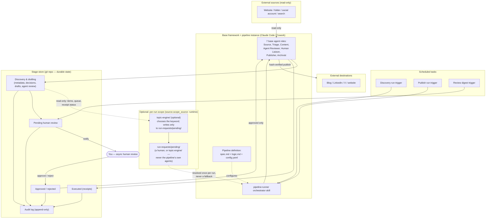

# High-Level Architecture

The five things that always exist, for every pipeline built on this
framework, and how they connect. See
[`01-detailed-architecture.md`](01-detailed-architecture.md) for the
stage-by-stage, agent-by-agent breakdown this collapses.

## Reading this diagram

- **Sources feed in read-only** — nothing in the framework ever writes back
  to a source (`docs/01-governance-rules.md`, Rule 1).
- **The pipeline definition configures the orchestrator, it doesn't run
  anything itself** — `spec.md`/`logic.md`/`config.yaml` are data the
  `pipeline-runner` skill reads, not code that executes.
- **Everything between discovery and "approved" sits in git**, because
  scheduled runs are stateless sessions (`docs/05-execution-model.md`).
- **Human review is the only path from "pending" to "approved"** — there is
  no automated route around it (Rule 3).
- **Destinations only ever hear from the framework once, per item, after
  approval and a hash check** (Rule 4).
- **`topic-engine/` is an optional producer, not a stage.** It reads the stage-store and writes nothing there —
  its one write is a new file in `run-requests/pending/` (enforced by tests,
  `docs/11-topic-engine.md`).
- **The per-run scope input is optional and dashed on purpose** — most
  pipelines never use it (`source.scope_source: fixed`, the default); a
  pipeline that opts into `runtime` still reads `config.yaml` for its fixed
  envelope, and this is only where the one varying value comes from
  (`docs/07-configuration-reference.md`, `docs/05-execution-model.md`).

## Keeping this in sync

This diagram should change only when something in that list above
changes — a new top-level component, a new external touchpoint, or a
change to which direction data/control flows. Day-to-day pipeline
additions (a new `pipelines/<name>/`) don't change this diagram at all,
since it's drawn at the level of the framework, not any one pipeline.
