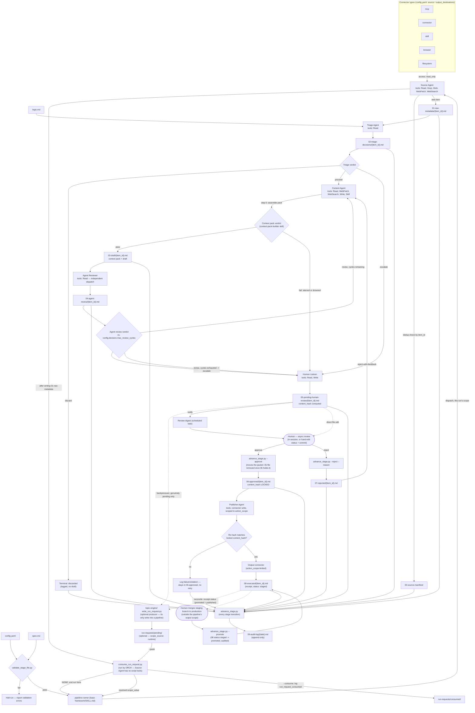
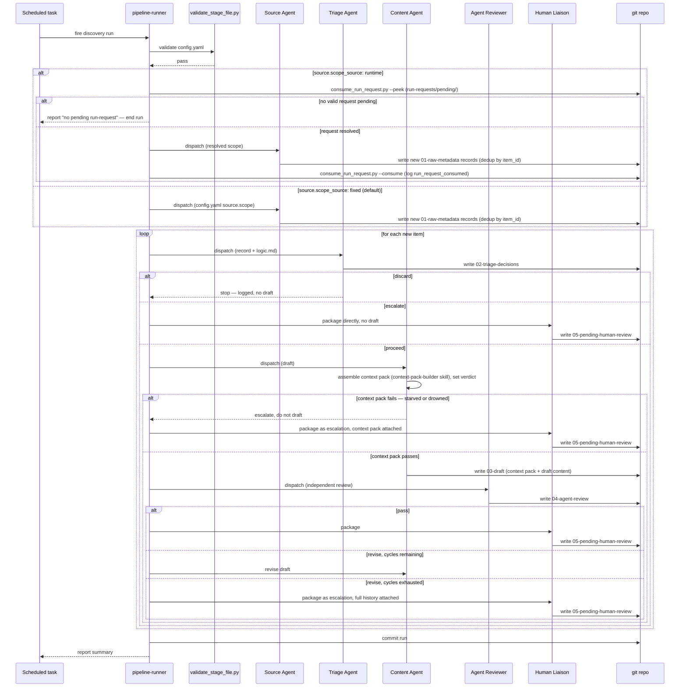
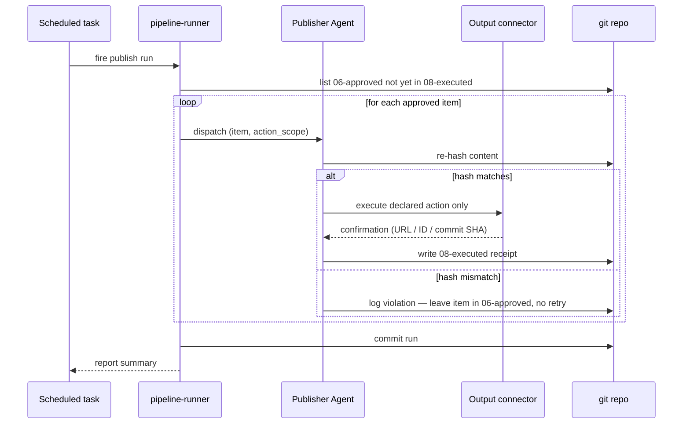

# Detailed Architecture

Three diagrams, together covering everything in
[`00-high-level-architecture.md`](00-high-level-architecture.md) at the
level of individual stage-store folders, agent tool grants, scripts, and
verdict branches. Node names match the file and folder names used
throughout `docs/` and `base-framework/` exactly, so this doubles as a map
from picture to file.

## 1. Structure and data flow

## 2. Discovery run — dispatch order

## 3. Publish run — dispatch order

## Reading these diagrams

- Diagram 1 is the one to check when you're unsure which script or agent
  touches which stage folder, or what a role's exact tool grant is.
- Diagrams 2 and 3 are the ones to check when you're unsure of *order* —
  what happens before what, and where a run can legitimately stop early
  (discard, a failed hash check) versus loop (a revise cycle).
- Every node name in diagram 1 is a real path or file named identically in
  `docs/03-stage-store-model.md`, `docs/04-agent-roles.md`, and
  `scripts/`. Nothing here is a level of abstraction above those docs.

## Keeping this in sync

Update this file whenever any of the following changes: a stage is added
or reordered (`docs/03-stage-store-model.md`), a role's tool grant or
position in the sequence changes (`docs/04-agent-roles.md`,
`base-framework/agents/*.md`), a script's behavior changes
(`scripts/*.py`), or the schema version in
`base-framework/spec/pipeline-spec.schema.md` bumps in a way that changes
any of the above. Bump `last_synced_with` in this file's frontmatter, and
in `00-high-level-architecture.md`, at the same time.
