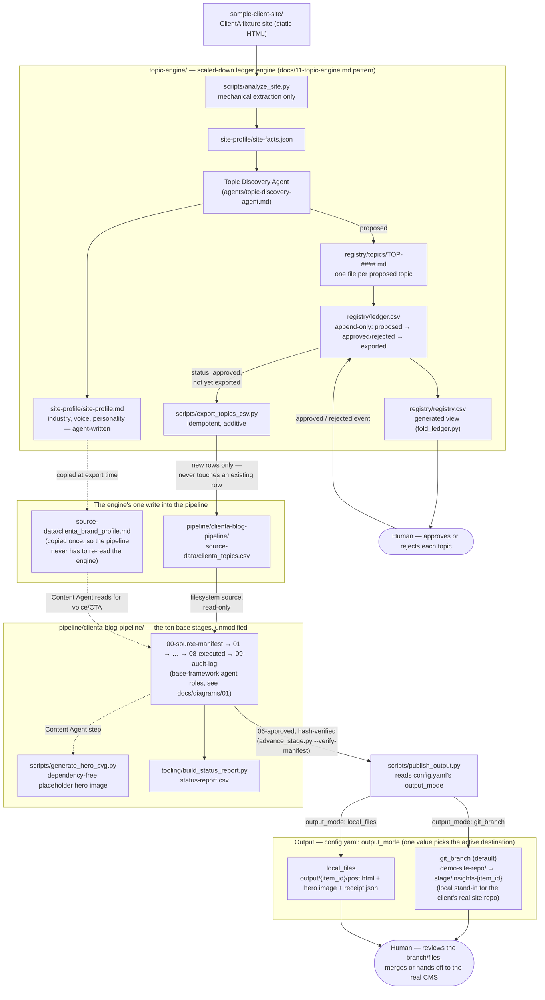

# agency-blog-pipeline — Example Architecture

This is a **pipeline-specific** diagram, deliberately separate from
[`../../docs/diagrams/00-high-level-architecture.md`](../../docs/diagrams/00-high-level-architecture.md)
and
[`01-detailed-architecture.md`](../../docs/diagrams/01-detailed-architecture.md),
which describe the base framework itself and say explicitly that they
stay unchanged by any one pipeline (`00-high-level-architecture.md`,
"Keeping this in sync"). Those two diagrams are still the right place to
understand the generic ten-stage shape, agent roles, and tool grants this
example inherits unmodified — this page only adds the concrete wiring
*specific to this example*: the topic-engine → CSV handoff, and the
configurable output-mode branch.

## 1. Structure and data flow



## 2. One concrete run — TOP-0001, start to finish

This traces exactly what's seeded in this checkout
(`pipeline/clienta-blog-pipeline/stage-store/`), not a hypothetical —
every step below corresponds to a real file you can open.

```mermaid
sequenceDiagram
    participant Eng as topic-engine
    participant H as Human (Harsh)
    participant Repo as clienta-blog-pipeline/ (git repo)
    participant Pub as publish_output.py
    participant Demo as demo-site-repo/

    Eng->>Eng: analyze_site.py → site-facts.json
    Eng->>Eng: Topic Discovery Agent writes site-profile.md, proposes TOP-0001..TOP-0005
    H->>Eng: approve TOP-0001..TOP-0004; reject TOP-0005
    Eng->>Repo: export_topics_csv.py → source-data/clienta_topics.csv (4 rows)

    Note over Repo: run-request scope_value=id=TOP-0001
    Repo->>Repo: Source Agent → 01-raw-metadata/TOP-0001.md
    Repo->>Repo: Triage Agent → 02-triage-decisions (proceed, logic.md Rule 4)
    Repo->>Repo: Content Agent → 03-draft (context pack + post body + hero SVG)
    Repo->>Repo: Agent Reviewer → 04-agent-review (pass; word-count flagged, not blocking)
    Repo->>Repo: Human Liaison → 05-pending-human-review (packaged)
    H->>Repo: advance_stage.py --approve TOP-0001
    Repo->>Repo: 06-approved (content_hash + manifest_hash locked)

    H->>Repo: advance_stage.py --verify-manifest TOP-0001
    Repo-->>H: OK — manifest hash matches
    H->>Pub: publish_output.py --item-id TOP-0001
    Pub->>Demo: checkout -b stage/insights-top-0001
    Pub->>Demo: write blog/top-0001.html + hero SVG, prepend blog/index.html entry
    Pub->>Demo: git commit (main untouched)
    Pub-->>Repo: receipt → 08-executed/TOP-0001.md (status: staged)

    Repo->>Repo: tooling/build_status_report.py → status-report.csv
    Note over H: TOP-0002..TOP-0004 remain approved + exported,<br/>not yet picked up — a realistic backlog
```

## Reading these diagrams

- **Diagram 1** is the one to check for "where does X file come from, and
  what writes to it" — every node is a real path.
- **Diagram 2** is the one to check for "what actually happened to
  TOP-0001" — open any `stage-store/*/TOP-0001.md` file alongside it.
- The dashed arrows (`-.->`) are read-only or copy-once relationships —
  never a write path back into something upstream. The topic engine never
  writes into the pipeline except the CSV export; the pipeline never
  writes back into the topic engine at all.
- Promotion (merging `stage/insights-{item_id}` into `main`, or handing
  local-mode files to a real CMS) is a human act outside both diagrams —
  same boundary `docs/03-stage-store-model.md` draws for every pipeline
  built on this framework.

## Keeping this in sync

Update this file if the topic-engine's ledger event vocabulary changes
(`topic-engine/schema/REGISTRY-SCHEMA.md`), if `output_mode` gains a
third destination, or if the CSV handoff schema changes
(`topic-engine/scripts/export_topics_csv.py`'s `CSV_COLUMNS`). Day-to-day
changes to *content* (new topics, a new worked item) don't change this
diagram — it's drawn at the level of this example's structure, not any
one run.
